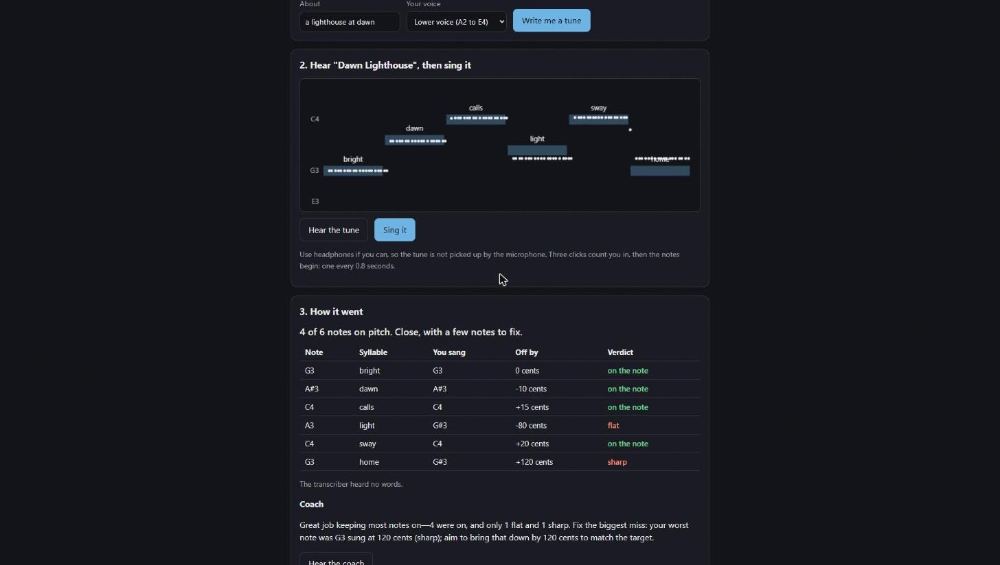

# Sing It Straight

[](https://pollinations.ai/?ref=badge)

**Live:** https://tomdacatto.github.io/pollinations-sing-it-straight/

Pollinations quest [#20022](https://github.com/pollinations/pollinations/issues/20022): practise singing and get feedback on what you sang, in a frontend-only web app, paid with the visitor's own Pollen.



## How it works

1. **A model writes the tune.** `openai/gpt-5.4-nano` returns JSON with 5 to 8 notes and one syllable each. Code refuses a tune that is out of your voice range, leaps more than a fourth, has too few different notes or does not match syllable to note, and sends the exact problems back to the model (up to three tries).
2. **You hear it, then sing it.** Three clicks count you in; a note lasts 0.8 seconds.
3. **Code measures your voice.** The pitch of each 2048-sample frame is found in the browser with the normalised square difference function ([`pitch.js`](pitch.js)), so no model's opinion is involved. Each note is scored on the middle of its window, in cents, and folded to the nearest octave so a lower voice is not marked wrong. A steady offset with good steps between notes is reported as "right tune, wrong place" instead of as six errors.
4. **A model explains the numbers.** The coach model is handed only what code measured and told not to invent any; `openai/tts-1` can read the advice aloud, and `openai/gpt-transcribe` writes down the words, which code compares to the lyric letter by letter.

All four models are free for every visitor (`paid_only: false` on `/v1/models`). A session costs a few thousandths of a Pollen.

## A real run

The microphone was a synthetic singer: a Web Audio sawtooth wave fed to the page through `getUserMedia`, with a known offset on each note, in desktop Chrome with the live code and my own key. The model wrote "Dawn Lighthouse" (G3 A#3 C4 A3 C4 G3). The app read back every offset I had put in:

| Note | Put in | The app said |
|---|---|---|
| G3 | 0 | 0 cents, on the note |
| A#3 | -10 | -10 cents, on the note |
| C4 | +15 | +15 cents, on the note |
| A3 | -80 | -80 cents, flat |
| C4 | +20 | +20 cents, on the note |
| G3 | +120 | +120 cents, sharp |

The coach then said 4 notes were on and named G3 at +120 cents as the worst, which matches the table. The screenshot above is that run. The whole session, including the earlier test calls, cost about 0.011 Pollen.

## Run the tests

```bash
npm test
```

11 `node --test` tests: pitch within 10 cents at five frequencies on a voice-like wave whose second overtone is stronger than its fundamental, silence and noise not read as a pitch, octave folding, per-note verdicts, the "all flat" and "one bad note" summaries, each reason a tune is refused, letter matching, and the coach prompt carrying the measured numbers.

## Not verified

- No human has sung into it. The microphone path was tested with a synthetic wave, not a voice; real voices have vibrato, breath and onsets that this does not model, and the score may be harsher or looser on them.
- Desktop Chrome only. Not tried on a phone, in Safari or in Firefox. MediaRecorder formats and microphone permission prompts differ there.
- The transcriber ran on the synthetic take (it heard no words, as it should). It transcribed a spoken test sentence exactly in a separate check, but I have not tried it on sung words, which it may miss.
- "Hear the coach" was clicked and the speech request returned without an error; I did not listen to it.
- The sign-in redirect on the live address was not run (the key was loaded into the page for the test).
- Headphones are recommended: without them the played tune can leak into the microphone.

MIT licence.
